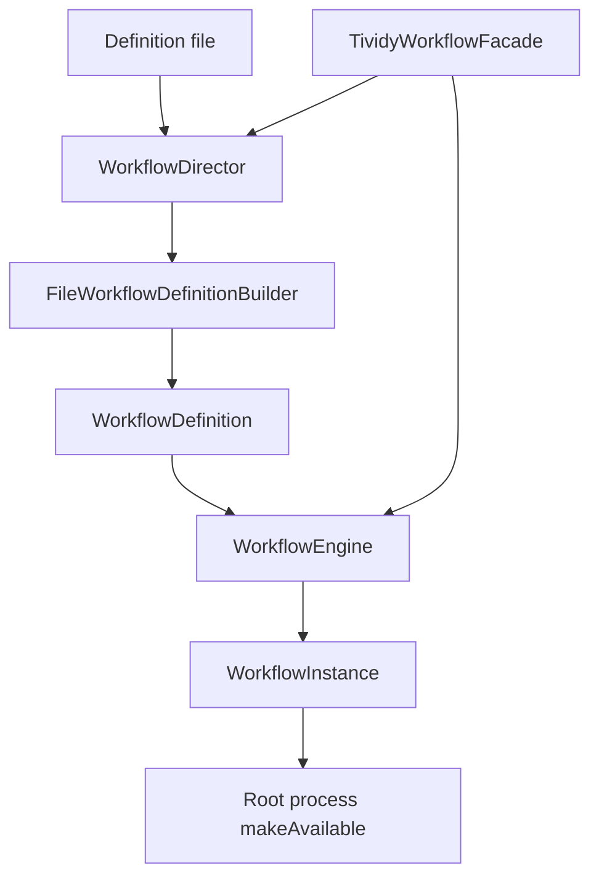
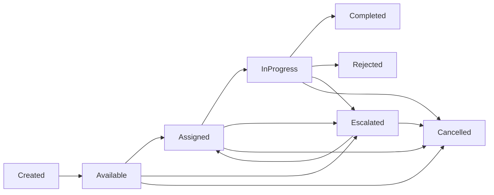
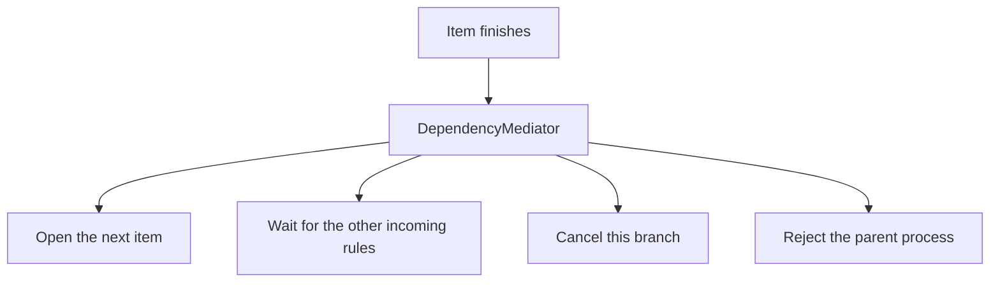
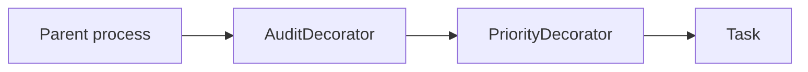

# TIVIDY

TIVIDY is a generic workflow engine. A workflow is a text definition: a tree of processes and tasks, dependency rules, routing, services, and optional priority or audit wrappers. The engine keeps those definitions and runs separate instances from them. Callers use `TividyWorkflowFacade`. `./tividy` only prints a short line and exits.

## How a workflow runs



The facade asks the director to build a definition, then asks the engine to keep it and start an instance. The instance is a clone of the definition tree.



1. A definition file is split into `DEFINITION`, `WORKITEMS`, `DEPENDENCIES`, `ROUTING`, `SERVICES`, and `EXTRAS`. Blank lines and lines that start with `#` are ignored.
2. `WorkflowDirector` drives `FileWorkflowDefinitionBuilder` in that same order. `construct` then returns the `WorkflowDefinition`. The builder no longer owns it.
3. The definition's root is a `SubProcess`. Processes own their children. A task is a leaf. Two live definitions cannot reserve the same id. A second definition built with an id that is already reserved keeps an empty id.
4. `WorkflowEngine::registerDefinition` stores the definition when the id is non-empty and not already registered. Otherwise it deletes the definition and returns an empty string. `registerDefinitionFromFile` does this from a path.
5. `startInstance` clones the definition tree into a `WorkflowInstance` with its own `InstanceData`. The definition stays the template. The instance id is `instance-1`, `instance-2`, and so on. `start` calls `makeAvailable` on the root.
6. Each work item delegates its lifecycle to a state object. A legal path is Created, Available, Assigned, InProgress, then Completed or Rejected. Available, Assigned, and InProgress can escalate to Escalated, which can be assigned again. Any non-final state can be cancelled. A state refuses a request that is not legal from there.
7. A task that becomes available asks its routing strategy for a participant. `RoleBasedRouting` uses one role name. `DataRuleRouting` reads one field from the instance data, maps values to roles, and uses the fallback role when the value is missing or unknown.


8. `DependencyMediator` decides what opens next from the definition's rules. A child with no incoming rule opens when its process opens. Several such children run together. A later item waits until every incoming rule is decided. It opens when at least one rule is satisfied, and it is cancelled when none are. `"*"` matches any successful completion. `"rejected"` matches `reject()`, not the reason text. A finished subprocess completes with outcome `"completed"`. If an item is rejected and no rule handles `"rejected"`, the parent is rejected and the rest of that branch is cancelled. The mediator is bound to a tree with `registerTree`. The instance created by the engine starts from an empty mediator until that registration is done.
9. Claim, start, complete, reject, delegate, and cancel go through the facade as commands. The engine keeps a command that succeeds and deletes one that fails. `undoLast` undoes the newest successful command.
10. `WorkflowInstance` can store a `WorkflowSnapshot` of item states, assignees, outcomes, and instance data, and can restore that snapshot.
11. State changes are published through the `EventDispatcher` singleton. Listeners such as `AuditLogger` record them. The engine owns listeners passed to `addListener`.
12. A task with a service name calls the `ExternalService` registered under that name. Adapters wrap the identity registry, the bank gateway, and the carrier tracking system.
13. Approval can be a chain of handlers. The task knows the first handler. Each handler approves or passes the request on. Deleting the head deletes the chain.

`checkDeadlines` is forwarded to the engine and does not scan instances yet.

## Definition file

```
DEFINITION
id|name|version

WORKITEMS
process|id|parentId|name
task|id|parentId|name

DEPENDENCIES
fromId|toId|outcome

ROUTING
itemId|role|roleName
itemId|data|field|fallbackRole|value|role|value|role

SERVICES
service|itemId|serviceName

EXTRAS
checkpoint|itemId
priority|itemId|level
audit|itemId
```



A process whose parent id is `-` is the root. `priority` sets the task escalation level and wraps the tree node in a `PriorityDecorator`. `audit` wraps that node in an `AuditDecorator`. The definition owns the logger, because the decorator does not. Wrapping replaces the node in its parent, and the decorator owns the previous node. Checkpoint and service lines are applied to the task, so a checkpoint for an item is listed before that item is wrapped.

`definitions/university_bursary.txt` and `definitions/shipment_exception.txt` are full examples. `tests/builder.txt` is the fixture for the builder tests.

## Layout

```
include/          public headers
src/              engine sources
definitions/      sample workflow files
tests/            doctest suites and tests/builder.txt
makefile          tividy and tividy_tests
Dockerfile        Ubuntu image used by docker compose
```

`src/decorator.cpp` is not part of the build. The decorator types are compiled from their own `.cpp` files.

## Build and run

Requirements are g++ with C++11, make, and, for the memory check, Valgrind. From the project directory:

```bash
make
make test
make valgrind
./tividy
```

`make test` builds `tividy_tests` and runs every suite. `make clean` removes `obj/`, `tividy`, and `tividy_tests`.

Docker builds the same targets and runs the tests:

```bash
docker compose run --rm tests
```

The `tividy` compose service copies `tividy` and `tividy_tests` onto the host and then runs `./tividy`.

Doxygen output goes to `docs/html/` after `make docs`.
