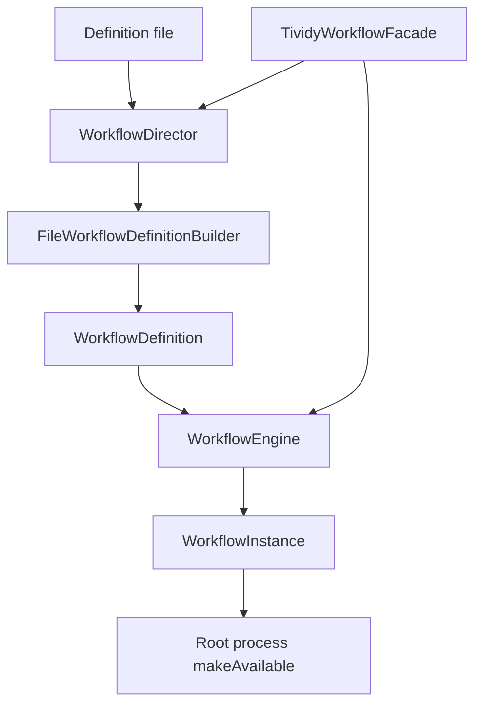
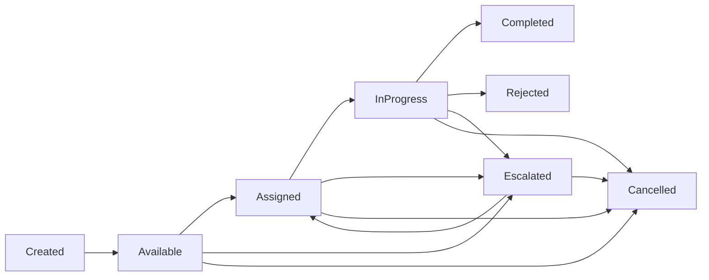
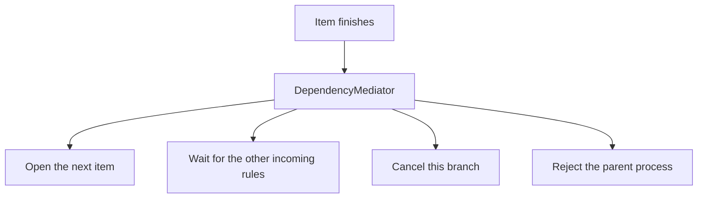
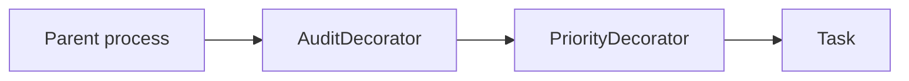

# TIVIDY

TIVIDY is a generic workflow engine. A workflow is a text definition: a tree of processes and tasks, dependency rules, routing, services, and optional priority or audit wrappers. The engine keeps those definitions and runs separate instances from them. Callers use `TividyWorkflowFacade`. `./tividy` is an interactive terminal interface (a TUI) that runs every industry in `scenarios/` through that same engine.

## Running the interface

From the project directory, run `make run` (or `docker compose run --rm tividy` to build and run interactively inside Docker, and `docker compose run --rm tests` to run the test suite). The interface reads `definitions/` and `scenarios/`, so it has to start here.

It opens by asking which workflow you want, then who you are from its participants. The main menu then covers only that workflow; `0` goes back to choose another, and exits from there. Menu option 5 changes participant, and a work item's menu offers **Act as the assignee**. Actions marked as allowed are the ones the engine will accept. The others stay selectable so that you can see the engine refuse them and why. In a table, `▸` marks work you can act on now. Colour turns off when output is not a terminal or `NO_COLOR` is set.

| TUI Key / Option | Where | What it does |
|---|---|---|
| `▸` | Work-item table | Marks a task or process you can act on right now |
| **Act as the assignee** | Inside a work item's menu | Switches your active participant directly to that item's assignee |
| **Allowed** vs other actions | Inside a work item's menu | Allowed actions succeed; disallowed actions stay selectable so you can see the engine refuse them and why |
| `u` | Instance screen | Restores the `WorkflowSnapshot` taken before the last action (cannot recall an external service call such as a bank payment) |
| `c` | Instance screen | Lists the `WorkItemAction` command history executed on that instance |
| `5` | Main workflow menu | Switch active participant within the current scenario's roster |
| `9` | Main workflow menu | View active task deadlines and advance the clock (in hours) to trigger SLA escalations |
| `0` | Any menu | Go back to choose another workflow, or exit from the opening screen |

A participant starts each instance and types in its details, because nothing about a run is stored in a file. The scenario says who may start it and what to ask. Completing some tasks asks for more, such as the bursary amount at Verify Funding Documents. The engine generates the instance id. These values match the test data behind the external services.

| To see | Enter or do |
|---|---|
| Education, completion | As Lerato Khumalo, start with surname `Mokoena` and ID `0501015800087`. Complete each task, and choose `approved` for the decision and the bursary |
| Who can start | Start as anyone but an Admissions Officer: it is refused |
| Identity rejection | A surname that doesn't match the ID: completing Verify Identity rejects the application and ends the instance |
| Appeal branch | Reject Verify Funding Documents: approval and payment are cancelled and the appeal opens |
| Data routing | Degree `Engineering` sends Academic Review to the Engineering Reviewer; any other degree goes to the Faculty Reviewer |
| Approval chain | At Verify Funding Documents, amount `15000` goes to the Bursary Officer, `60000` to the Finance Manager and `200000` to the Committee |
| Delegation | Open a task assigned to you, choose Delegate, and pick someone with the same role, such as Naledi Dube for Lerato Khumalo. Anyone else is refused |
| Roles | Open a task as someone without its role and try to claim it, or open its details to see the role it needs |
| Payment failure | Amount `200000` is over the bank limit: completing Pay Bursary escalates it. Claim it to retry |
| Logistics, completion | As Bongani Dube, start with waybill `WB1002`. Choose `reroute` or `hold` at Assess Impact, and enter hub `Cape Town` at Reroute Shipment |
| Service failure | ID `123`, waybill `WB9999` or hub `Polokwane`: the call fails and the task escalates. Someone qualified claims it, starts it, and corrects the value when completing it |
| Deadline | With Approve Bursary open, main menu option 9 lists what is due and when. Entering that many hours moves it up the approval chain, and the Committee keeps it at the top. Assess Impact escalates until someone with the role claims it |
| Commands | `c` on an instance screen lists the commands the engine has run for it |
| Independence | Start two instances of one workflow and advance only one |
| Undo | `u` on an instance screen restores the snapshot taken before the last action. It cannot recall an external call such as a payment |
| Healthcare, admission | As Amahle Dlamini, surname `Mokoena`, ID `0501015800087`, acuity anything other than `Critical`. Choose `admit` |
| Healthcare, routing | Acuity `Critical` sends the clinician, the admission decision, and the ward round to Dr Carla Venter |
| Insurance, payment | As Neo Khumalo, the same surname and ID. Assess with `accept`. Amount `15000`, account `62012345678`, branch `250655`. Approve with `approved` |
| Insurance, decline | Assess with `decline`: settlement is cancelled and the decline notice opens. Amount `20000` stays with the assessor, `60000` goes to the manager, `200000` to the committee |
| Manufacturing, pack | As Kabelo Naidoo, product line `Electronics`, then `pass` at Inspect Quality. `Food` uses the food line. Any other line uses the general line |
| Manufacturing, rework | `fail` at Inspect Quality packs nothing and opens Rework Failed Batch |

## Using definitions and scenarios

A workflow that a person can run is two files. They do different jobs, and only one of them is read by the engine.

The **definition** (`definitions/*.txt` or `definitions/*.definition`) is the workflow. `TividyWorkflowFacade::registerDefinitionFromFile` hands the path to `WorkflowDirector`, which drives `FileWorkflowDefinitionBuilder`. The builder returns a `WorkflowDefinition`. The engine keeps that object as the template. `startInstance` clones it into a `WorkflowInstance` with its own data. Claim, start, complete, reject, delegate, cancel, undo, and deadlines then run on that instance. The engine never opens a scenario file.

The **scenario** (`scenarios/*.scenario`) is read only by the terminal interface. It names which definition to offer, who the people are, which role may start an instance, which questions to ask, and which outcome buttons to show. The interface turns that into facade calls: `addParticipant` for each `PARTICIPANT`, `InstanceData::set` for each answer, then `startInstance`, `claim`, `complete`, and the rest. A program that calls the facade itself does not need a scenario. It registers the participants and fills `InstanceData` in code. The tests do that. See [tests/README.md](tests/README.md).

The two files have to use the same words, or the interface will start and the engine will refuse the work.

| What has to match | In the definition | In the scenario |
|---|---|---|
| Workflow id | The id on the `DEFINITION` line | `WORKFLOW` |
| Role text | Every role in `ROUTING` | `PARTICIPANT` roles, and `STARTED_BY` when it is set |
| Task id | The id on a `task` line | The task id on `TASK_FIELD` and `OUTCOMES` |
| Outcome text | The third field of a `DEPENDENCIES` line, other than `*` and `rejected` | A choice in `OUTCOMES` for the task that finishes |
| Data key | A `data` routing field, an `approval` field, or a name a service reads | The key on `FIELD` or `TASK_FIELD` |

`*` and `rejected` belong only in the definition. `*` matches any successful completion, including a process that finishes with `completed`. `rejected` matches `reject()`, not the reason text and not a word typed at complete. A completion choice such as `admit`, `approved`, `pass`, or `reroute` must be the same string in `OUTCOMES` and in `DEPENDENCIES`.

`STARTED_BY` is checked by the interface before it calls `startInstance`. The engine itself starts an instance for whatever roster it is given. `FIELD` is asked when the instance starts. `TASK_FIELD` is asked when that task is completed, and only when the engine will accept the completion. Neither file stores the answers. The interface writes them into that instance's `InstanceData`, which is what routing and the service adapters read.

These service names are already registered in `Tui::initialise`. The scenario key has to be the name the adapter reads. A different key makes the call fail, and the task escalates.

| `service` name | Keys the adapter reads |
|---|---|
| `IdentityVerificationService` | `idNumber`, `surname`. Surname `Mokoena` and ID `0501015800087` verify. A different surname rejects the task. `123` is not 13 digits, so the call fails and the task escalates |
| `PaymentGateway` | `amount` in rands, `accountNumber` of 9 to 11 digits, `branchCode`. Account `62012345678` and branch `250655` are accepted. Amount `200000` is over the transfer limit and the task escalates |
| `TrackingService` | `waybill`. `WB1002` is known. `WB9999` is not, and the task escalates |
| `CarrierAdapter` | `waybill` and `destinationHub`. Hubs it serves are `Johannesburg`, `Durban`, `Cape Town`, and `Gqeberha`. `Polokwane` fails and the task escalates |

A definition that names a service not in that list also needs an adapter registered in `Tui::initialise`. Until then, completing that task escalates it.

The interface offers a workflow when both files are present and the ids match.

| Industry | Definition | Scenario | Id |
|---|---|---|---|
| Education | `definitions/university_bursary.definition` | `scenarios/education.scenario` | `UNI_BURSARY` |
| Logistics | `definitions/shipment_exception.definition` | `scenarios/logistics.scenario` | `SHIP_EX` |
| Healthcare | `definitions/hospital_admission.definition` | `scenarios/healthcare.scenario` | `HOSP_ADMIT` |
| Insurance | `definitions/insurance_claim.definition` | `scenarios/insurance.scenario` | `INS_CLAIM` |
| Manufacturing | `definitions/production_order.definition` | `scenarios/manufacturing.scenario` | `PROD_ORDER` |


From the project directory, `./tividy` or `make run` reads both folders. Choose the industry, then a participant whose role is `STARTED_BY`. The questions are that scenario's `FIELD` lines. The buttons at complete are its `OUTCOMES` lines. The tree, the states, and a refusal come from the definition.

Code uses the definition only. The roster string is the same idea as one scenario file: participants in another roster are not offered this instance.

```cpp
TividyWorkflowFacade facade;
facade.addService(new GovernmentIDAdapter());
std::string id = facade.registerDefinitionFromFile("definitions/hospital_admission.definition");
facade.addParticipant("clerk", "Amahle Dlamini", {"AdmissionsClerk"}, "healthcare");

InstanceData data;
data.set("surname", "Mokoena");
data.set("idNumber", "0501015800087");
data.set("acuity", "Critical");
facade.startInstance(id, data, "healthcare");
```

Pass that same roster to later `claim`, `complete`, and `findParticipant` calls. The definition id in `startInstance` is the id on the `DEFINITION` line, which is what `registerDefinitionFromFile` returns.

## Adding a workflow

No code changes or rebuild are needed. When the interface starts, it builds every `definitions/*.txt` and `definitions/*.definition` file and reads every `scenarios/*.scenario` file. A workflow appears in the opening list once a scenario names its id. Anything that can't run yet appears in a **Not ready** box with the reason, and the rest carry on working.

1. Add `definitions/my_workflow.definition`. The `#` lines above the first section are its description, and the format is under [Definition file](#definition-file).

   ```
   # What this workflow does.

   DEFINITION
   MY_WORKFLOW|My Workflow|1

   WORKITEMS
   process|ROOT|-|My Workflow
   task|FIRST|ROOT|First Task
   task|SECOND|ROOT|Second Task

   DEPENDENCIES
   FIRST|SECOND|*

   ROUTING
   FIRST|role|Clerk
   SECOND|role|Manager
   ```

2. Add `scenarios/my_workflow.scenario`. `WORKFLOW` must match the id on the definition's `DEFINITION` line, and at least one `PARTICIPANT` is required.

   ```
   WORKFLOW|MY_WORKFLOW
   INDUSTRY|Retail
   EXPECTED|What should happen when it finishes.
   STARTED_BY|Clerk
   PARTICIPANT|p1|Sam Clerk|Clerk
   PARTICIPANT|p2|Alex Boss|Manager
   FIELD|orderNumber|Order number
   OUTCOMES|SECOND|approved,declined
   ```

   `INDUSTRY`, `EXPECTED`, `STARTED_BY`, `FIELD`, `TASK_FIELD` and `OUTCOMES` are optional:

   - `STARTED_BY` is the role allowed to start an instance. Without it, any participant can.
   - `FIELD|key|prompt` is a detail typed in when an instance starts, and `TASK_FIELD|itemId|key|prompt` is one typed in when that task is completed. The file only names what to ask; values are never stored.
   - `OUTCOMES` is the choices offered when completing that task. Without it, you type an outcome.
   - A participant may hold several comma-separated roles.

Each scenario owns its participants: work is only routed to, and only accepted from, people in that scenario's file. The same names, ids and roles can appear in any number of scenarios, and two people are simply different participants. A workflow that calls a new external system also needs an adapter registered in `Tui::initialise`; until then, that task escalates when it runs.

## How a workflow runs



The facade asks the director to build a definition, then asks the engine to keep it and start an instance. The instance is a clone of the definition tree.



1. A definition file is split into `DEFINITION`, `WORKITEMS`, `DEPENDENCIES`, `ROUTING`, `SERVICES`, and `EXTRAS`. Blank lines and lines that start with `#` are ignored.
2. `WorkflowDirector` drives `FileWorkflowDefinitionBuilder` in that same order. `construct` then returns the `WorkflowDefinition`. The builder no longer owns it.
3. The definition's root is a `SubProcess`. Processes own their children. A task is a leaf. Two live definitions cannot reserve the same id. A second definition built with an id that is already reserved keeps an empty id.
4. `WorkflowEngine::registerDefinition` stores the definition when the id is non-empty and not already registered. Otherwise it deletes the definition and returns an empty string. `registerDefinitionFromFile` does this from a path.
5. `startInstance` clones the definition tree into a `WorkflowInstance` with its own `InstanceData`. The definition stays the template. The instance id is `instance-1`, `instance-2`, and so on. `start` calls `makeAvailable` on the root.
6. Each work item delegates its lifecycle to a state object. A legal path is Created, Available, Assigned, InProgress, then Completed or Rejected. Available, Assigned, and InProgress can escalate to Escalated, which can be assigned again. Any non-final state can be cancelled. A state refuses a request that is not legal from there.
7. A task that becomes available asks its routing strategy for a participant. `RoleBasedRouting` uses one role name. `DataRuleRouting` reads one field from the instance data, maps values to roles, and uses the fallback role when the value is missing or unknown.


8. `DependencyMediator` decides what opens next from the definition's rules. A child with no incoming rule opens when its process opens. Several such children run together. A later item waits until every incoming rule is decided. It opens when at least one rule is satisfied, and it is cancelled when none are. `"*"` matches any successful completion. `"rejected"` matches `reject()`, not the reason text. A finished subprocess completes with outcome `"completed"`. If an item is rejected and no rule handles `"rejected"`, the parent is rejected and the rest of that branch is cancelled. The mediator is bound to a tree with `registerTree`. The instance created by the engine starts from an empty mediator until that registration is done.
9. Claim, start, complete, reject, delegate, and cancel go through the facade as commands. The engine keeps a command that succeeds and deletes one that fails. `undoLast` undoes the newest successful command.
10. `WorkflowInstance` can store a `WorkflowSnapshot` of item states, assignees, outcomes, and instance data, and can restore that snapshot.
11. State changes are published through the `EventDispatcher` singleton. Listeners such as `AuditLogger` record them. The engine owns listeners passed to `addListener`.
12. A task with a service name calls the `ExternalService` registered under that name. Adapters wrap the identity registry, the bank gateway, and the carrier tracking system.
13. Approval can be a chain of handlers. The task knows the first handler. Each handler approves or passes the request on. Deleting the head deletes the chain.

## Definition file

```
DEFINITION
id|name|version

WORKITEMS
process|id|parentId|name
task|id|parentId|name

DEPENDENCIES
fromId|toId|outcome

ROUTING
itemId|role|roleName
itemId|data|field|fallbackRole|value|role|value|role
itemId|approval|field|role|limit|role|limit|finalRole

SERVICES
service|itemId|serviceName

EXTRAS
checkpoint|itemId
priority|itemId|level
audit|itemId
deadline|itemId|hours
```



A process whose parent id is `-` is the root. `priority` sets the task escalation level and wraps the tree node in a `PriorityDecorator`. `audit` wraps that node in an `AuditDecorator`. The definition owns the logger, because the decorator does not. Wrapping replaces the node in its parent, and the decorator owns the previous node. Checkpoint and service lines are applied to the task, so a checkpoint for an item is listed before that item is wrapped.

`definitions/university_bursary.definition`, `definitions/shipment_exception.definition`, `definitions/hospital_admission.definition`, `definitions/insurance_claim.definition`, and `definitions/production_order.definition` are full examples. `tests/builder.txt` is the fixture for the builder tests. The section [Using definitions and scenarios](#using-definitions-and-scenarios) is how those files are paired with `scenarios/*.scenario` and handed to the engine.

## Layout

```
include/          public headers
src/              engine sources
definitions/      workflow files the engine runs (`.txt` and `.definition`)
scenarios/        interface files: participants, details to ask for, and outcome choices (`.scenario`)
tests/            doctest suites and tests/builder.txt
makefile          tividy and tividy_tests
Dockerfile        Ubuntu image used by docker compose
```

`src/decorator.cpp` is not part of the build. The decorator types are compiled from their own `.cpp` files.

## Build and run

Requirements are g++ with C++11, make, and, for the memory check, Valgrind. From the project directory:

```bash
make
make test
make valgrind
./tividy
```

`make test` builds `tividy_tests` and runs every suite. `make clean` removes `obj/`, `tividy`, and `tividy_tests`.

Docker builds the same targets and runs the tests:

```bash
docker compose run --rm tests
```

The `tividy` compose service copies `tividy` and `tividy_tests` onto the host and then runs `./tividy` interactively (`docker compose run --rm tividy`). On pull requests targeting `main`, the GitHub Actions pipeline (`.github/workflows/tag.yml`) automatically runs `docker compose run --rm tests`, runs the Valgrind memory check, extracts the compiled `tividy` binary artifact, and publishes a tagged GitHub Release.

Doxygen output goes to `docs/html/` after `make docs`.
